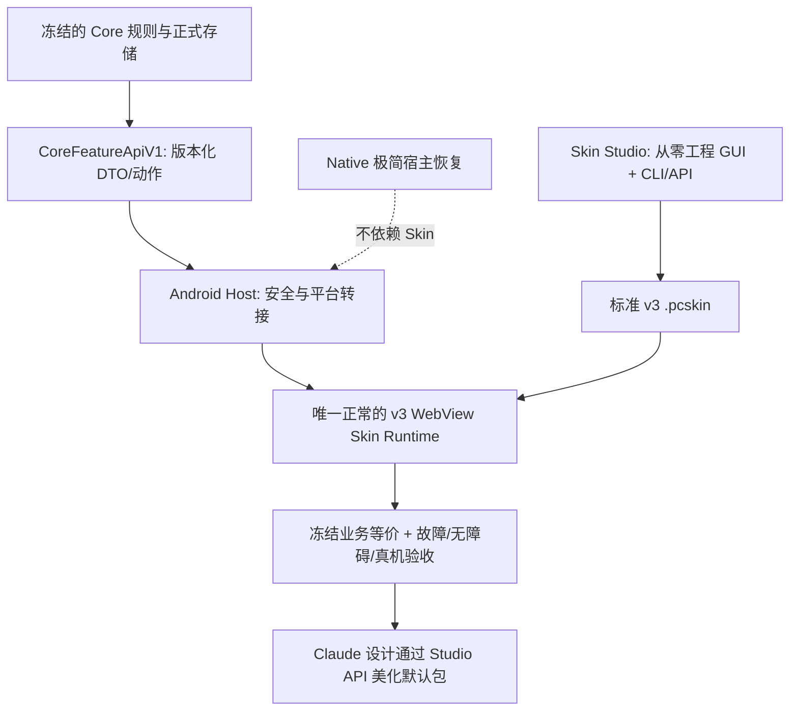

# PowerCal · 单一默认皮肤 / Core–Skin–Studio 分离工程施工路线图

**计划版次：PLAN-2026-11-03-R2｜状态：仅计划、未经执行｜适用基线：`origin/feat/skin-first-separation` = `5c88150e4e13061021935614ca4fc98e33fe7f93`**
**仓库：** `E:\Project\Powerful-Calendar`
**建议执行工作区：** 以远端集成 HEAD 创建唯一干净工作树。现有 `...\.local\android-test\worktrees\handoff-recurrence-20261103` 在审计时干净且与远端同步，但不要求覆盖它。
**基准与证据：** `main=af229d98`（核心冻结签核）；历史完整 JVM 946/946 PASS；Studio Python 68/68 PASS；SEP 母项 0/16 完整签核。**这些是历史证据，不代表后续修改自动通过。**
**2026-11-03 Owner 最新裁决（覆盖本版旧的历史皮肤保留条款）：正式 App 只允许一套默认 `.pcskin`；历史安装的第三方/候选皮肤包不保留，不提供迁移后归档或导出。R-03 负责在隔离 QA 环境验证将旧选择收敛到默认或 Native 安全恢复，并清除仅限 App 私有 `files/skin-packs/` 的旧安装包。此裁决不授权删除 Git Worktree、设计源稿、Studio 项目、测试夹具、其他用户文件，也不授权提前向生产用户放开切换。业务 Store 不可修改。**

**2026-11-06 Owner 视觉基准更正（覆盖本路线图中关于默认皮肤视觉目标、Clear 作为最终视觉 fallback 及 Claude 设计输入时序的旧裁决）：唯一正式默认皮肤的视觉、页面结构与交互基准是冻结原生 PowerCal 0.9.5-rc.1，源码 `b1f7629f0c52812e1887443872f43aa6c49908c4`，参考 APK `.local/android-test/artifacts/physical-qa/PowerCal-0.9.5-rc.1-b1f7629-debug-core-HOLD.apk`（SHA-256 `DCD35A1CB0A5DED6D51ACB0B9275A2EE3BF1D8D107631AA640A58D73FC626F76`）。当前 Clear 仅是唯一既有包身份与迁移载体，不是视觉验收终点；未经批准的 Claude 概念不作为目标。通过正式 Skin Studio/Web v3 迁移原生页面表现与交互；不恢复第二套正常 Runtime，Native 仅保留独立安全恢复。原生参考中的框外标题、贪心折叠、真实时间几何、双翼布局和冻结交互不得静默降级。此更正不改变 Core 语义、Skin ID、唯一 `.pcskin` 身份或现有安全门禁。**

## 0. 最终产品与禁止偏离的原则

### 唯一目标

1. **Core 只管功能。** 事件、身份、存储、事务、重复、日期与时区、提醒、草稿/审批、AI 业务、导入导出、规则和稳定的版本化公开 API。Skin 看不到 Core 私有对象、数据库引用、密钥或原始系统文件 URI。
2. **Skin 只管表现。** 页面、组件、导航、布局、颜色、动画、无障碍标注、对 Core 状态的可视化和对已许可 API 的调用。不得复制一个新的重复事件引擎、校验器、事务器或提醒调度器。
3. **Host 是窄适配层，不是第二套 Core。** 保有 Android WebView、系统权限、SAF 文件选择、可信确认对话框、凭据与错误恢复；通过 `CoreFeatureApiV1` 执行功能。不得另写业务规则。
4. **正式 App 只带一个默认 `.pcskin`。** 继续使用已存在的 `powercal-clear-default` ID / `powercal-clear-default.pcskin`，暂不改名、暂不重做视觉。**取消正常产品的“可用皮肤”多选目录和编译型候选。** Native Compose 只保留必要的宿主保护 UI/灾难恢复途径；安全回退并不算第二套正常皮肤。
5. **Skin Studio 能从零建一个新的、功能完备的表现层。** 不靠复制 Clear、手改 Android App 或修改 Core；可创建页面/组件、绑定公开状态和动作、预览、导出 `.pcskin`、重新导入编辑、装载在 Android Runtime。仍可保留源代码高级编辑模式。Studio 的 GUI 和 CLI/API 使用同一 v3 项目/包定义。
6. **美化最后。** Claude 的已有设计图只是 Phase 5 输入；在 Core / Skin / Studio 路径验收前不做任何大规模 UI 美化、素材生成或 AI 自动创作系统扩张。

### 目标依赖图



**特别校正：** `:core-api` 合约已经独立，实际实现一部分仍位于 `:app`。这本身不意味着必须马上把几万行代码整体搬到新的 Gradle module。验收关心**业务决策权、依赖方向、接口调用和行为等价**。仅当确有静态越界，才做最小范围物理迁移，避免陷入无收益的大重构。

### 不可破坏的约束

- 永不修改、清理或覆盖冻结 `main` 中的用户数据语义；`docs/CORE_FREEZE_ACCEPTANCE_LEDGER.csv` 的现有未提交改动为受保护资产。
- 绝不对有未提交工作的 Worktree 运行 `reset --hard`、`git clean -fdx` 或直接删除目录；不使用 `git push --force`。
- **最新 Owner 裁决：历史 App 已安装皮肤包不保留。** R-03 仅清理应用私有 `files/skin-packs/` 内符合旧安装包身份的 `.pcskin`；清理前核对目录范围及业务 Store 不变量，失败则安全退回 Native 并报告。不得删 Git Worktree、Studio 源项目、旧设计图、测试夹具、外部 SAF 文件或其他数据。禁止保留第二套正常默认皮肤。
- 保留隐藏/可达的独立宿主恢复路径和 Host 可信写入确认；Skin JavaScript 无审批权。
- 首次默认切换必须延迟到功能和恢复验收以后，且区分**全新安装**与**旧安装迁移**。内部 QA 可以通过隔离安装测试默认启动，不可将测试偏好直接写进用户设备。
- 没有设备回放的结果写 `NOT TESTED`；测试跳过写 `SKIP`；超时写 `FAIL` 或 `INCONCLUSIVE`，不可通过其他测试代替。

## 1. 文件所有权地图（Agent 先查这些，不再全文重读 2,539 行 PROGRESS）

| 责任 | 现有文件 / 目录 | 执行原则 |
|---|---|---|
| 领域 API 合约 | `core-api/src/main/kotlin/dev/powerfulcalendar/core/api/v1/*.kt` | 只补确有缺口的正式 API/DTO，不增加任意 UI 参数 |
| 领域 API 适配 | `app/src/main/java/dev/powerfulcalendar/core/api/v1/PowerCalCoreFeatureApiV1.kt`、`Store*FeatureApiV1.kt`、`Android*FeatureApiV1.kt` | Core 实现及 Host/Android Port；避免复制业务 |
| 冻结领域行为 | `app/src/main/java/dev/powerfulcalendar/core/PowerStore.kt`、`TemporalModels.kt`、`ReminderPolicy.kt`、`app/.../reminders/*.kt` | 默认只读；已有错误需有独立证据与明确授权才改 |
| Android 入口 | `app/src/main/java/dev/powerfulcalendar/MainActivity.kt` | 启动装载、独立恢复触摸、生命周期 |
| UI/Host 总控 | `app/src/main/java/dev/powerfulcalendar/ui/v2/PowerCalApp.kt` | 业务 API 注入、权限/文件/可信确认；逐条削减重复逻辑，不做全文件重写 |
| 皮肤包与选中状态 | `.../ui/v2/SkinPackageManager.kt`、`SkinAssets.kt` | 唯一默认、旧选中迁移、验证、恢复、只读资源 |
| WebView Host | `.../ui/v2/SkinnableChrome.kt`、`WebSkinHost.kt`、`WebSkinStateFeed.kt`、`WebSkinEditBridge.kt` | 唯一正常 v3 Runtime、可信通信和状态投影 |
| 各功能展示投影 | `WebSkinTimelineProjection.kt`、`WebSkinMonthProjection.kt`、`WebSkinMemoProjection.kt`、`WebSkinReminderDiagnosticsProjection.kt`、`WebSkinSystemDiagnosticsProjection.kt` | Host 从 API 投影成 DTO，严禁产生第二套业务规则 |
| 旧表现层路径 | `PresentationSkinRuntime.kt`、`RuntimeSkinCompose.kt`、`RuntimeSkinSurfaces.kt`、`CompiledSkinTimeline.kt`、`RuntimeSkinPickerHost.kt`、`ui/v2/skins/ActiveVisualSkin.kt`、`StudioExample*.kt`、`native-skin/` | 分批退役/隔离，不能一口气删除 Native 恢复所依赖的控件 |
| 唯一默认皮肤源码 | `tools/skin-studio/default-clear/manifest.json`、`source/project.json`、`source/web/index.html`、`app.js`、`edit.js`、`style.css`、`clear-design.css`、`title-folding.js` | 暂不美化；只修功能接口、可访问性和最低限度状态一致性 |
| 唯一出厂包 | `app/src/main/assets/powercal-clear-default.pcskin` | 必须只由规范源码构建，字节校验；不可直接二进制手改 |
| Studio GUI | `tools/skin-studio/index.html`、`v3-studio.js`、`style-v3.css` | 新建/组件树/绑定/预览/资源/打包 GUI |
| Studio HTTP/CLI | `tools/skin-studio/skin_studio.py`、`blank_project_v3.py`、`blank-starter/`、`project_ops_v3.py`、`runtime_package_v3.py`、`studio_v3_preview.py` | API/命令行须复用生产 v3 包校验与单一项目模型 |
| 测试 | `app/src/test/.../ui/v2/*Skin*Test.kt`、`app/src/androidTest/.../ui/v2/*Skin*InstrumentedTest.kt`、`tools/skin-studio/tests/*` | 新断言尽量加现有测试类；设备测试要标注精确 APK/AVD |
| 当前验收 | `docs/SKIN_SEPARATION_PARITY_MATRIX_2026-10-27.md`、`docs/CORE_FEATURE_API_V1.md`、`docs/SEPARATION_REMOTE_GOVERNANCE_AND_ROADMAP_2026-10-30.md` | 历史证据保留、有效签核按最新代码证据更新；不要无限新增 Issue |

## 2. 执行方法：小工作包，不做“连续五天同一个 Agent”

每一个任务卡就是**一轮独立 Agent 会话**。每轮严格遵守：

1. 读取本计划的 **“唯一下一任务 ID”**，以及该卡引用的实际代码和最多两个相关测试/文档；通过 `git status` 与 `git log` 检查是否已做，不阅读所有历史记录。
2. 先给出三行微计划：改动文件、预期测试、演示场景；不重新规划架构、不索要项目总目标。
3. 一次只实施一个卡片；若出现额外问题，登记 `BLOCKER`，不顺手扩张到 Studio 高级能力、AI 工具或美术。
4. 验证严格区分静态、单元、Android Runtime、手动真机，使用恰当基线和新数据；非相关长测试可按风险层级执行，但**切换默认 / 删除旧运行时 / 合并里程碑前必须执行全门禁**。
5. 提交约定式 commit，普通 fast-forward push 到唯一集成远端；提交只包含本轮允许文件。每次提交后写一段简短证据：`HEAD` / 任务 ID / 改动 / PASS-FAIL-SKIP / 风险 / 唯一 NEXT ID。
6. **立即结束这一轮会话。** 新 Agent 根据下一任务继续；不能自己发散开启新任务。429 时停止该会话的远程重试，不改工程流程。

### 建议一套唯一的当前交接入口

实施 **G-03** 后新建 `docs/agent-handoff/CURRENT.md`（不覆盖旧 `PROGRESS.md`），内容始终不超过约 100 行：

```
BASE_REMOTE_HEAD=<40-char SHA>
CURRENT_PHASE=G|R|F|S|Q|V
NEXT_TASK=<唯一任务 ID>
LAST_COMPLETE=<任务 ID + commit>
PASS=<一行实证和日志相对路径>
FAIL=<失败及复现方式；没有填 none>
BLOCKERS=<阻塞；没有填 none>
PROTECTED_WORKTREES=<未合并改动清单的索引>
DECISION=<不变的 Core/Skin/Studio 原则和链接>
```

历史长日志只归档为证据；**“同时保留多个 NEXT_ACTION”是文档错误**，必须在 G-03 清零。最新裁决中文已出现真实 `?` 损坏，必须修复并通过 UTF-8 字符检查。

### 通用验证命令（Windows PowerShell，切到任务工作树后执行）

```powershell
# 只作为运行模板；先根据实际设备/SDK/工作树路径修正。
git status --short
git rev-parse HEAD
git diff --check

$env:ANDROID_HOME = 'E:\android-sdk'
$env:ANDROID_SDK_ROOT = 'E:\android-sdk'
.\gradlew.bat :app:verifySkinSourceBoundary :app:verifyNativeSkinBoundary :app:testDebugUnitTest :app:assembleDebug :app:lintDebug :app:compileDebugAndroidTestKotlin --offline --no-daemon --max-workers=1 --no-parallel --console=plain

python -m unittest discover -s tools/skin-studio/tests -p 'test_*.py'
node --check tools/skin-studio/v3-studio.js
node --check tools/skin-studio/default-clear/source/web/app.js
python tools/skin-studio/build_default_clear.py --verify --apk app/build/outputs/apk/debug/app-debug.apk

& 'E:\android-sdk\platform-tools\adb.exe' devices -l
# 只操作先以 `adb -s <serial> emu avd name` 核实名称的 QA AVD。
& 'E:\android-sdk\platform-tools\adb.exe' -s <serial> shell am instrument -w -r -e class '完整测试类#方法' dev.powerfulcalendar.test/androidx.test.runner.AndroidJUnitRunner
```

日志建议保存在现有忽略目录 `.local/android-test/reports/single-default-<TASK-ID>/`；保留命令、stdout、JUnit XML、APK 和 `.pcskin` 哈希、AVD 名称。**不要只引用以前的绿灯**。

## 3. Phase G — 先把工程整理到可施工状态（不修改产品行为）

### G-01｜锁定唯一执行分支和基准

- **先读**：`AGENTS.md`、`docs/CORE_CONTRACT_FREEZE_2026-10-21.md`、`docs/SEPARATION_REMOTE_GOVERNANCE_AND_ROADMAP_2026-10-30.md` 的顶部裁决；`git worktree list --porcelain`；`git status`。
- **改动**：仅建立独立干净工作树和执行分支 `codex/skin-single-default-closure`，基于新读取的 `origin/feat/skin-first-separation`；不改 App 文件。勿在落后 471 提交的旧 `skin-first-separation` 工作树施工。
- **验收演示**：显示新工作树 `git status --porcelain` 为空；`git merge-base --is-ancestor origin/feat/skin-first-separation HEAD` 成功；记录当前 40 位 SHA。
- **退出**：一写者、一基线；如远端移动，必须先停下比较而不是强推。
- **提交**：不需要代码提交；工作树创建和 HEAD 记入 G-03。

### G-02｜保护并分类 28 个 Worktree 和未提交改动

- **先读**：每个工作树 `status --porcelain=v1`、`diff --stat`、`log -1`；重点：`main` 的验收 CSV、`chatgpt-core-handoff-20261103` 的 4 处 WebView 诊断、`delivery-final-*` 的两处 AndroidTest、`ai-error-studio-verify-*` 的 GUI 编辑、`pc-issue-172-*` 的 AI 未提交工作。
- **改动**：新建 `docs/agent-handoff/WORKTREE_DISPOSITION.md`，逐一记录路径、HEAD、已提交/未提交、所属功能、和最新主线重合程度、是否保留/待复核/可以日后清理。**不进行自动合并、删除和恢复。**
- **验收演示**：清单恰覆盖全部 worktree；列出每一处脏工作树的受保护修改及冲突候选；主仓库状态前后无变化。
- **退出**：每个工作区都有归属与处置状态；没有“随便删掉”项。
- **提交**：`docs(repo): inventory concurrent worktrees without deleting artifacts`。

### G-03｜修复目标文档，消灭互相冲突的 NEXT_ACTION

- **改动文件**：`docs/SEPARATION_REMOTE_GOVERNANCE_AND_ROADMAP_2026-10-30.md`、`docs/agent-handoff/PROGRESS.md`；新建 `docs/agent-handoff/CURRENT.md`，可选 `docs/agent-handoff/ARCHIVE_INDEX.md`。保留旧进度全文为不可变历史，不剪掉测试证据。
- **动作**：用本计划第 0 节重建顶部损坏的中文裁决；UTF-8 校验顶区不含连续乱码问号；旧文档中明确标注“历史 NEXT_ACTION 已过期”，CURRENT 只指向 `G-04`。
- **演示**：`python` 读取文件，断言顶部有“Core”“Skin”“Studio”“唯一默认皮肤”中文、无连续 3 个 ASCII `?`；`git diff` 证明只有文档。
- **退出**：无两个互相矛盾的当前行动入口；Agent 重启只需读 CURRENT+当前任务卡。
- **提交**：`docs(goal): restore single-skin directive and canonical handoff index`。

### G-04｜建立可复验的干净技术基线

- **测试，不新增产品功能**：`verifySkinSourceBoundary`、`verifyNativeSkinBoundary`、完整 JVM、Debug APK、Lint、AndroidTest 编译、Studio Python、JS syntax、默认包源码/APK 哈希。
- **文件**：若只有日志，不改源码；记录 `docs/agent-handoff/CURRENT.md`，日志进入忽略目录。若失败，仅做失败分类（代码回归/旧 flaky/依赖或 AVD 环境），不能顺手修十个问题。
- **演示**：报告最新确切的总测试数、失败方法、APK SHA、Studio 测试数。QA AVD 设备名可读，无法使用则标 NOT TESTED。
- **退出**：获得可对照的干净基线；任何红灯具备复现/隔离结果；不能拿旧 946/946 代替本轮。
- **提交**：`test(baseline): record clean single-skin migration baseline`（仅测试报告/当前状态）。

### G-05｜重写有限验收清单：把旧 16 个 SEP 映射到新产品

- **改动**：新建 `docs/agent-handoff/SINGLE_SKIN_ACCEPTANCE.md`，引用而不复制 `docs/SKIN_SEPARATION_PARITY_MATRIX_2026-10-27.md` 的 16 母项及其已有证据。
- **逐项定义**：唯一出厂/启动、时间轴、月历、Memo、四类事件创建/编辑/删除、三类重复作用域、草稿、AI/提案、设置/权限/导入导出、提醒与重启、可信审批、Studio 创作、损坏皮肤恢复、无障碍。为每项列 `SOURCE`/`CORE API`/`DEFAULT SKIN`/`STUDIO`/`ANDROID QA`/`PHYSICAL` 六栏。
- **演示**：以每项一条“用户动作→调用 API→可观察 Store/界面结果”的方式输出表；取消的旧多皮肤目录标 RETIRED-BY-OWNER，不再要求产品实现，但旧文件保护/恢复测试不能豁免。
- **退出**：每个原有功能有明确归属、测试方法和可签核条件，下一任务 `R-01`。
- **提交**：`docs(acceptance): translate SEP coverage into one-default-skin acceptance`。

## 4. Phase R — 从产品视角只保留一套默认皮肤（先保护，再切换）

### R-01｜画出全部 Skin 入口与副作用，停止并行机制扩张

- **只读文件**：`SkinPackageManager.kt`、`MainActivity.kt`、`PowerCalApp.kt`、`SkinnableChrome.kt`、`RuntimeSkinPickerHost.kt`、`RuntimeSkinCompose.kt`、`PresentationSkinRuntime.kt`、`ui/v2/skins/ActiveVisualSkin.kt`、`native-skin/.../NativeSkinCatalogReview.kt`。
- **产出**：`SINGLE_SKIN_ACCEPTANCE.md` 附表记录每个入口：何时调用、是否用户可见、是否影响 Store、能否被单一 WebView Runtime 代替、哪些代码仍供 Native 应急使用。
- **演示**：明确指出 `currentId()` 初始值是 `powercal-default`；`ActiveVisualSkin.PROFILE="native"`；以及 Native / Web / Compiled / v2 DSL 并存。不得直接删除。
- **退出**：旧机制每个入口确定“保留恢复 / 保留 Host / 从日常 UI 退役 / 测试兼容保留”的归属。
- **提交**：`docs(skin): classify all runtime dispatch paths before retirement`。

### R-02｜默认包不变名、但构造单一“正常表现层”的选择策略

- **改动**：`SkinPackageManager.kt`（新增明确的唯一工厂包解析/有效性查询与 `restoreSelection` 策略），必要时 `SkinAssets.kt`（仅注册态）。保留当前 `powercal-clear-default` 标识；APK 中仍只一包；`powercal-default` 只作为恢复标记。
- **关键策略**：新安装在**隔离 QA 测试通道**可以自动激活唯一默认包；历史 Native 选择、用户安装包、异常包、掉电后的选择分别在 `R-03` 显式迁移。正式公开默认开关不得在此任务直接放出。
- **测试**：在 `app/src/test/java/dev/powerfulcalendar/ui/v2/SkinPackageManagerTest.kt` 添加 `fresh-install factory`, `corrupt factory -> native`, `idempotent restore`, `no Store touch`。
- **演示**：隔离 QA AVD 全新安装，第一页进入唯一默认 Web 运行时；损坏的测试包转 Native，记录 Store/偏好不失效；不触碰个人设备。
- **退出**：默认包从未经过分叉解码，回退无死循环；仍保留产品切换门禁。
- **提交**：`feat(skin): define single-factory activation and safe boot policy`。

### R-03｜把历史选择安全迁移成“默认 / 恢复”两态

- **改动**：`SkinPackageManager.kt`、`PowerCalApp.kt` 启动时读取选中值的边界；新增 `SingleSkinSelectionMigrationTest.kt` 或扩展既有 `SkinPackageManagerTest.kt`。
- **策略（2026-11-03 Owner 覆盖）**：隔离 QA 的全新安装→唯一默认 Clear；旧 Native→保持独立安全恢复选择，不假装有第二套日常皮肤；旧 Clear→保持；旧第三方选择→验证并切换到唯一 Clear（默认包无效则 Native），在确认新状态可启动及必要迁移状态可恢复后，**删除应用私有 `files/skin-packs/` 中全部历史安装 `.pcskin`，不归档、不导出、不保留原 ID 作为可选皮肤**；未知/损坏 ID→Native，旧安装包同样清理。可显示一次性的迁移说明，但不能要求用户回选旧包。Calendar Store/草稿/提醒/AI 历史不得改变。生产环境强制迁移仍受 Cutover HOLD 门禁约束。
- **演示**：针对上述五种状态分别在隔离 QA AVD 冷启动两次；核对最终只有 Clear 正常表现层或 Native 恢复、历史安装包目录无残留 `.pcskin`、事件 seq/revision、草稿、提醒 intents 不变。删除只限隔离测试应用私有目录；模拟删除失败时禁止报告迁移成功，不扩大删除范围。
- **退出**：旧选中项安全收敛，只有一个正常默认皮肤与独立 Native 恢复；应用私有历史 `.pcskin` 已按 Owner 新裁决清理，第二次启动不重复迁移；任何 Core 业务数据和仓库设计资产均未损失。
- **提交**：`fix(skin): retire historical installed skins and migrate selection safely`。

### R-04｜从 Native 正常设置移除旧“可用皮肤”目录

- **改动**：`native-skin/src/main/java/dev/powerfulcalendar/ui/v2/nativeui/NativeToolsPage.kt`、`app/src/main/java/dev/powerfulcalendar/ui/v2/PowerCalApp.kt`、`PresentationSkinRuntime.kt` 中 Settings Visual Context 装配段；`native-skin/.../NativeSkinCatalogReview.kt` 仅在没有其他恢复引用时才退役。
- **保留**：工厂包解析校验、必要的 Studio/QA 兼容验证、SAF 通用平台操作、Native 可信确认、设置/备份/权限/提醒入口；**不保留历史已安装包的产品导出/回选入口**。不能因为移除皮肤目录而删除其他系统功能。
- **测试**：更新 `NativeSkinCatalogReviewComposeTest.kt` 及相关 UI 测试，过时的“多选目录应可见”测试改为“正常界面不可见、测试/恢复能力仍存在”。
- **演示**：Native 恢复页仍能访问紧急备份和权限功能，但没有多皮肤列表/切换/商店；项目事件不变化。
- **退出**：产品级多皮肤选择 UI 不可达；开发支持 API 尚保留。
- **提交**：`refactor(settings): retire native skin catalogue from everyday UI`。

### R-05｜从 Clear Settings 移除多皮肤候选管理入口

- **改动**：`tools/skin-studio/default-clear/source/web/index.html`、`app.js`、`style.css`；`PowerCalApp.kt` 中 `WebSkinAction.SelectSkin/ImportSkin/...` 的分发**改为普通页面不可达**；保留其他业务所需的 Host SAF/确认能力，但不保留历史皮肤导出或多选入口；使用 `build_default_clear.py` 生成 APK asset，绝不直接 ZIP 修改。
- **测试**：`WebSkinBridgeTest.kt`、`ClearSettingsOptionsInstrumentedTest.kt`；Studio `e2e_clear_studio_bridge.cjs` 按新目标更新。禁止用字符串删除造成事件处理器空引用。
- **演示**：进入默认 Settings，可用提醒、AI 受保护参数、备份等正式功能；看不到选择第二套皮肤、删除安装包等日常入口；Skin JS 无法私自发出未授权的 Host action；Host 错误仍有可视反馈。
- **退出**：UI 不再宣传“迁移预览/多候选皮肤”；系统功能与 UI 回退不受影响。
- **提交**：`refactor(skin): remove candidate-skin catalogue from default settings`。

### R-06｜退役编译型示例和 v2 正常入口，保留验证夹具

- **改动候选（先跑 `git grep` 使用点）**：`ui/v2/skins/ActiveVisualSkin.kt` 中 `studio-example` 选择与 `StudioExample*.kt`；`RuntimeSkinCompose.kt`、`RuntimeSkinSurfaces.kt`、`RuntimeSkinPickerHost.kt`、`PresentationSkinRuntime.kt`。根据 R-01 引用图只做“不可到达/减少一条 dispatch”及最小编译清理。`tools/skin-studio/examples/` 继续保留为测试 fixture 或归档，不打进正式 APK。
- **硬限制**：不要把 `:native-skin` 整个模块删除；它仍提供 Host 安全对话框和恢复；不要为删除 v2 不小心打断 v3 包解析。
- **测试**：`verifySkinSourceBoundary`、`verifyNativeSkinBoundary`、相关 `RuntimeSkinPackageTest.kt`、`NativeSkinRecoveryTest.kt`、完整编译；按新的 deprecated/compat 语义更新测试。
- **演示**：App 只能启动 Web 默认或安全 Native；改变旧 compiled profile 常量不再改变正常 UI；出现损坏 Web 皮肤仍能进安全界面。
- **退出**：一个正常运行时、一条独立恢复路径；没有产品可达的第三、第四种 renderer。
- **提交**：`refactor(runtime): retire compiled and v2 daily presentation branches`。

### R-07｜单一 Runtime 启动门禁（尚不向老用户 cutover）

- **改动**：`MainActivity.kt`、`SkinnableChrome.kt`、`WebSkinHost.kt`、`SkinPackageManager.kt` 的启动/失效切换处；必要时 `PowerCalApp.kt` 统一 `fullCanvasWeb` 判定。
- **测试**：`WebSkinCorruptPackageColdRecoveryInstrumentedTest.kt`、`WebSkinRendererRecoveryInstrumentedTest.kt`、`ClearProcessRestartRecoveryInstrumentedTest.kt`、`NativeSkinRecoveryTest.kt`；只在隔离 AVD 做清空测试数据。
- **演示**：新装→默认首页；进程结束/恢复→默认首页；有未保存表单时杀 Web renderer→恰好一个恢复草稿+Native 安全页；导入坏包不得自动激活；重启依然可进。
- **退出**：QA 默认和恢复路径可靠；对旧用户公开切换仍 HOLD，等待 F/Q。
- **提交**：`test(runtime): gate single-default boot and independent recovery`。

## 5. Phase F — 逐功能闭合“Core 功能 / Skin 表现”（与 Studio 同域配对实施）

**原则：不因为 API 文件多就继续新增 API。先以 `docs/CORE_FEATURE_API_V1.md` 的现有接口作每域断言；只有真实行为不能通过当前契约实现，才改 `core-api`。**

### F-01｜业务调用与展示调用的源代码责任扫描

- **只读**：`PowerCalApp.kt`、`WebSkinEditBridge.kt`、`WebSkinHost.kt`、`WebSkin*Projection.kt`、`native-skin`；`core-api/src/main/.../*FeatureApiV1.kt`。重点搜索 `PowerStore` / `DeckController` / `RecurrenceEngine` / `ReminderPolicy` / 自行解析时间 / 任意 StateFlow 变换。
- **文档**：在 `SINGLE_SKIN_ACCEPTANCE.md` 每个功能标记“Core 正式规则 / Host 平台或许可 / Skin 纯展示 / 需要修复的越界点”，只留具体可复现缺陷，不泛化为“把 :app 全部搬到 :core-api”。
- **演示**：展示两个反例和两条已正确通过 API 的路径，给出对应行号与替代契约。
- **退出**：修复候选是有限、带测试的清单；下一步 F-02。
- **提交**：`docs(core): make finite host-versus-domain boundary checklist`。

### F-02｜时间轴及导航：统一 Camera/窗口/事件点击

- **文件**：`WebSkinTimelineProjection.kt`、`NativeTimelineHostAdapter.kt`、`NativeTimelineProjection.kt`、`WebSkinHost.kt`、`PowerCalApp.kt`；默认皮肤 `web/app.js` 和 `style.css`。复用 `CalendarFeatureApiV1` / `RecurrenceFeatureApiV1`，手势像素属于 Skin，转为标准动作请求后由 Host/Core 完成合法性检查。
- **功能/演示**：相同测试 Store：今日定位本地中午、24h 恢复、缩放、两侧独立滚动、时间轴拖动新建与移动、事件点击。记录时间轴位置及最终事件/草稿状态；Native 安全基线与默认包结果一致。
- **测试**：`TimelineReturnViewportInstrumentedTest.kt`、`TimelineCreateContextWebViewInstrumentedTest.kt`、`TimelineDragWebViewInstrumentedTest.kt`、`WebSkinHostProjectionTest.kt`。
- **退出**：Camera/正式写入一致，Skin 不负责 recurrence 业务；所有主要入口可用。
- **提交**：`fix(parity): close timeline core-to-skin actions`。

### F-03｜月历：唯一事件查询与重复实例渲染

- **文件**：`WebSkinMonthProjection.kt`、`WebSkinStateFeed.kt`、`WebSkinHost.kt`、`PowerCalApp.kt`、默认 `web/app.js` 的 `renderMonth` / `message` 接收段。先在干净 HEAD 复现此前实验 worktree 的“Host 11 月 3 日 occurrence 存在但 DOM 不显示”；失败日志仅作线索，**不能直接合入未验证 hello 调试补丁**。
- **功能/演示**：建立跨月 daily ACTIVITY；11 月 2/3/4/5 等重复实例均出现在默认 Skin 月历；点击正确 owner/revision/occurrenceKey；月切换、日期创建、Today、进程重启后结果一致。
- **测试**：`NativeClearMonthOccurrenceParityInstrumentedTest.kt`、`WebSkinRecurrenceInstrumentedTest.kt`、`WebSkinMonthProjectionTest.kt`（若不存在，在现有 `WebSkinHostProjectionTest.kt` 中扩展）；无效状态/时序必须可复现。
- **退出**：新鲜 QA AVD 上 2 次连续完整执行通过，Host 状态与 DOM 对得上，不能只看 Host JSON；无 Store 非预期写入。
- **提交**：`fix(month): synchronize recurring occurrence projection and rendering`。

### F-04｜Memo、待办与完成状态

- **文件**：`WebSkinMemoProjection.kt`、`PowerCalApp.kt`、`WebSkinEditBridge.kt`、默认 `web/app.js` 的 `renderMemo`；复用 `MemoFeatureApiV1`、`EventFeatureApiV1.setOccurrenceCompletion()`。
- **功能/演示**：无日期 Memo、新建、Open/Done 过滤、同系列一个 occurrence 完成/撤销、251 行续页、点击标题打开并不改变完成状态；重启后状态一致。
- **测试**：`ClearMemoProjectionInstrumentedTest.kt`、`WebSkinMemoProjectionTest.kt`（若缺失用 `WebSkinHostProjectionTest.kt`）、`WebSkinBridgeTest.kt`。
- **退出**：同一 row key/revision/occurrence，避免 Skin 承担核心去重或完成逻辑。
- **提交**：`fix(memo): close single-runtime completion and paging parity`。

### F-05｜四类编辑器、草稿队列、正式确认与恢复

- **文件**：`WebSkinEditBridge.kt`、`PowerCalApp.kt`、`SkinnableDraftDeck.kt`、`NativeDraftDeckHost.kt`；默认 `web/edit.js`、`web/index.html`；复用 `EventFeatureApiV1` / `DraftReviewFeatureApiV1`。
- **演示**：ACTIVITY/ALARM/DEADLINE/MEMO 各自无修改打开→无写入关闭；有效修改→Host 确认→一次正式提交；保存不完整→待处理草稿；取消正式删除→零写入；冲突版本→有提示且保留草稿；进程重启→恢复。
- **测试**：`WebSkinAllKindsTrustedWriteInstrumentedTest.kt`、`WebSkinFormalDeleteTouchInstrumentedTest.kt`、`WebSkinEditBridgeTest.kt`、`ClearProcessRestartRecoveryInstrumentedTest.kt`。
- **退出**：Skin 只编辑表单/请求操作，正式变更必须由 Core/Host 判断；Store 变更次数与冻结基线一致。
- **提交**：`fix(editor): close four-kind draft and trusted-write parity`。

### F-06｜重复规则三种作用域、日期精度及 DST

- **文件**：`WebSkinEditBridge.kt`、默认 `web/edit.js`；API `core-api/.../RecurrenceFeatureApiV1.kt`、`EventFeatureApiV1` 对应实现只在发现不可表达场景时最小补充。严禁在 Skin 内展开自有 recurrence engine。
- **演示**：同一重复系列分别 Single / This-and-future / Whole；逐个展示 occurrence key、目标 eventSeq、拆分结果、失败拒绝及原系列不受影响；覆盖日期型 Deadline 和秋季 DST 首次实例选择。
- **测试**：`WebSkinRecurringScopeParityInstrumentedTest.kt`、`WebSkinRecurrenceBridgeTest.kt`、`RecurrenceFeatureApiV1Test.kt`。
- **退出**：每种作用域在 Native/默认包产生等价正式记录和草稿；无自造时序语义。
- **提交**：`fix(recurrence): align scope actions with core recurrence contract`。

### F-07｜AI 聊天、提案及批次审核——只修已有功能等价，不扩展 AI 能力

- **文件**：`PowerCalApp.kt`、`WebSkinHost.kt`、`WebSkinEditBridge.kt`、`app/.../core/api/v1/StoreAiFeatureApiV1.kt`；默认 `web/app.js`。核心 API `AiFeatureApiV1` / `AiProposalFeatureApiV1` 已有，不开新 Agent/模型自动化开发线。
- **演示**：本地确定性 Stub：聊天→历史持久化→编辑/撤回/重新发送→附件授权→结构化 CREATE/STAGE/REPLACE/DELETE→用户显式审批；未批准前 Store 不可变，错误和重试有清晰显示。
- **测试**：`WebSkinHostProjectionTest.kt`、`WebSkinTrustedWriteReviewTest.kt`、`WebSkinAllKindsTrustedWriteInstrumentedTest.kt` 及已有 AI 实测类；不把 Stub 当作真实提供商可靠性证据。
- **退出**：没有 AI 功能需要借 Native 日常页面完成；凭据、URI、文件内容及审批令牌不进入 Skin。
- **提交**：`fix(ai-ui): close existing host-reviewed AI presentation paths`。

### F-08｜权限、提醒、ICS、系统日历、备份/恢复与安全设置

- **文件**：`WebSkinReminderDiagnosticsProjection.kt`、`WebSkinSystemDiagnosticsProjection.kt`、`PowerCalApp.kt`、默认 `web/app.js` 的 `renderSettings`；复用 `ReminderFeatureApiV1`、`ImportExportFeatureApiV1`、`SettingsDataFeatureApiV1`。系统页面/SAF/权限和凭据仍由 Host，允许原生受信对话框或设置表单但不作为整套 Native 正常皮肤。
- **演示**：提醒 permission 拒绝→BLOCKED→授权→恢复调度；文件 ICS 只入草稿；系统日历一次性导入；备份→空库恢复，坏 hash 拒绝且 Store 无写；用户选择取消→零写入。模拟器仅验证平台路径，OEM 闹钟投递必须真机独立验收。
- **测试**：`ClearSettingsOptionsInstrumentedTest.kt`、`WebSkinManualReminderReconcileIntegrationTest.kt`、`WebSkinRendererRecoveryInstrumentedTest.kt`、`ReminderAlarmManagerDeliveryInstrumentedTest.kt` 等现有测试。
- **退出**：系统能力有明确 Host 显示与结果反馈；Skin 从未收到密钥或任意 SAF URI；未发生不可逆数据改变。
- **提交**：`fix(settings): complete host-platform controls on default skin`。

### F-09｜所有页面统一 Back/IME/失效与最低限度可访问性

- **文件**：`MainActivity.kt`、`SkinnableChrome.kt`、`WebSkinHost.kt`、`PowerCalApp.kt`、默认 `web/app.js` / `web/index.html` / `web/style.css`。只做输入和结构性可用性，不做 Claude 风格化。
- **演示**：每页 Back；IME 显示时首次 Back 仅关键盘；清洁和脏编辑器离开；Web 进程崩溃；2× 字体、小屏、竖屏、减少动画、TalkBack 主要按钮顺序。
- **测试**：`ClearNavigationBackInstrumentedTest.kt`、`WebSkinRendererRecoveryInstrumentedTest.kt`、`TimelineSystemFontScaleInstrumentedTest.kt`、`TimelineSmallScreenInstrumentedTest.kt`。
- **退出**：不会因皮肤异常丢弃未保存编辑；无不可触达关键操作。
- **提交**：`fix(accessibility): close host and default-skin input/recovery contract`。

## 6. Phase S — Studio 必须真正从零创建“可调用 Core 的完整皮肤”

**与 F-02…F-09 并行按相同领域验证，但不共用同一次 Agent 会话：完成一个 F 功能域后执行对应 S 子任务；两者都 PASS 才认为该领域闭环。**

### S-01｜升级现有空白工程为可以持续编辑的规范工程

- **文件**：`tools/skin-studio/blank-starter/manifest.json`、`source/project.json`、`source/web/{index.html,app.js,style.css}`、`blank_project_v3.py`、`skin_studio.py`、`v3-studio.js`。
- **动作**：保留真正独立的 `blank-v3`，不复制 Clear；为每个页面建独立可编辑的空槽/组件节点和唯一 ID；manifest 默认 host.read，只有插入 mutating action 才显式申请 `host.action` 并给出风险说明。
- **演示**：点击 Studio“新建空白皮肤”→看到五个空页面入口→编辑名称/文件→另存→重开仍保留层级；`project.json` 无被动注入的 Clear 设计元素。
- **测试**：`test_v3_preview.py`、`test_single_default_distribution.py`、`test_project_ops_v3.py`。
- **退出**：真正空项目独立创建/二次编辑/唯一 ID/项目结构稳定。
- **提交**：`feat(studio): make blank v3 projects durable and multi-page`。

### S-02｜页面与组件结构 GUI（不能只剩源码输入框）

- **文件**：`tools/skin-studio/index.html`、`v3-studio.js`、`style-v3.css`、`project_ops_v3.py`，必要时增小文件 `studio-component-schema-v1.json` 统一校验。
- **动作**：五个页面可增删重排组件：文本、容器、滚动区、时间刻度/事件卡、月格、Memo 行、表单字段、按钮、聊天项、设置行、资源图层；组件有 ID、父子树、props、数据绑定、样式；支持撤销/恢复，保存时写回真正 HTML/CSS/JS 或被生产 runtime 理解的 project 结构。**不能只把任意 JSON 摆在编辑器里却不作用于 WebView。**
- **演示**：从空白项目用鼠标新建 Month、拖入月格、添加日期按钮和 Header，调序、删除、撤销、保存；预览 DOM 和导出后的结构相同。
- **测试**：扩展 `tests/e2e_v3_source.cjs`、`test_project_ops_v3.py`；资源/嵌套/未知属性不能丢失。
- **退出**：可通过 GUI 构造/重构页面结构，而不仅改已有 Clear HTML。
- **提交**：`feat(studio): add editable page tree and component composition`。

### S-03｜Core API 动作与状态绑定目录（Studio 不创造新业务）

- **文件**：`tools/skin-studio/v3-studio.js`、`studio_v3_preview.py`、`skin_studio.py`、`docs/V3_HOST_BRIDGE_EXTENSION.md` 或单独正式绑定 manifest；Runtime 对应 `WebSkinHost.kt`、`WebSkinEditBridge.kt` 只有必要的映射修复。
- **动作**：把**现有真实** Bridge action/state schema 编成受限可查询的绑定目录：名称、版本、请求参数、响应/错误、required capability、示例显示组件。UI 下拉选择后自动生成绑定代码和必需权限；对不存在的 action 报校验错误，不能新建未授权快捷命令。
- **演示**：空白 Skin 添加“今日”按钮→选择正式 Host action→预览显示 Mock camera 更新→导出的 Android Skin 点击后真正回到本地中午；只读皮肤点正式写入被拒绝。
- **测试**：`test_http.py`、`test_v3_source_editing.py`、`WebSkinCapabilityGateInstrumentedTest.kt`。
- **退出**：完整接口字段可以从机器可读合同发现；错误处理结构化，Studio 与 Runtime 绝无两套名字或业务规则。
- **提交**：`feat(studio): expose versioned host-state and action binding catalog`。

### S-04｜预览必须对应 Android Runtime 的真实语义

- **文件**：`studio_v3_preview.py`、`v3-studio.js`、`tests/e2e_v3_browser.cjs`、`tests/e2e_clear_studio_bridge.cjs`；Android `WebSkinResourceParityInstrumentedTest.kt`。
- **动作**：Mock 只模拟**输出**和用户拒绝/允许路径，标清“非正式写入”；版本/能力/错误字段都遵循正式 Bridge。提供 Timeline/Month/Memo/AI/Settings 五套可切换的固定数据夹具；统一 Web 资源路径/CSP/MIME、字体和相对 URL。
- **演示**：在 Studio 改一个文案和 API 绑定→Chrome 预览成功/失败都与实际 WebView 的可见结果一致，正式 Store 在 Mock 预览期间零写入。
- **测试**：Studio Python、Chrome/Edge E2E、`WebSkinResourceParityInstrumentedTest.kt`。
- **退出**：除 Android 特有权限弹框外，预览表现与设备运行可对照。
- **提交**：`fix(studio): align preview bridge contract with Android runtime`。

### S-05｜完整资源、源码编辑与版本化发布 API

- **文件**：`project_ops_v3.py`、`runtime_package_v3.py`、`skin_studio.py`、`v3-studio.js`、`tests/test_runtime_v3.py`、`tests/test_v3_source_editing.py`、`tests/test_android_delivery_fixture.py`。
- **动作**：支持图片/字体/二进制资源与任意合法 UTF-8 文件、未知元数据无损保存；禁止资源路径穿越、旧资源引用悬空、自动权限升级；打包可复现，响应输出包含 errors/warnings、文件 hash、schema 版本、required capability；API/CLI/GUI 均可执行 build/validate/inspect/read/edit/export/import。
- **演示**：从 blank 添加 PNG、WOFF2、JS 文件→导出→重新导入→继续编辑→每个文件 SHA 与引用保持一致；投递坏 ZIP 得稳定错误，不替换原工程。
- **测试**：Studio 全 Python+E2E，Android resource parity；测试包不能被安装后获得未声明权限。
- **退出**：任意自定义皮肤工程可无损多次编辑并构建，不依赖 Clear。
- **提交**：`feat(studio): make v3 project resources and package tooling lossless`。

### S-06｜真正的“从零创作完整正常皮肤”端到端验收

- **文件**：主要在 `tools/skin-studio/blank-starter`、`v3-studio.js`、相关组件 schema / CLI；新增一套**仅位于测试目录**的生成结果，如 `tools/skin-studio/tests/fixtures/from-blank-functional/`，不可加入 `app/src/main/assets/` 成为第二工厂包。
- **一步步演示（必须完整录像/截图/日志）**：新建 Blank → 用 GUI 创建 Timeline、Month、Memo、AI、Settings 页面 → 绑定 Core read/action → 新建四类事件并通过 Host 确认 → 编辑/删除/重复 scope → Memo 完成 → AI Stub 发送、草稿审核 → 备份/权限/提醒状态 → 导出 `from-blank.pcskin` → 重新导入 Studio → 再编辑一个组件 → 安装至**独立 QA AVD** → 点击真实 Android 触控 → Force-stop 冷启动仍可用。
- **测试**：新建 `StudioFromBlankFullRuntimeInstrumentedTest.kt`（测试 App 的 AndroidTest）；浏览器 E2E；Android Test 只验产品功能，自动化 Stub 不触网；用 `SINGLE_SKIN_ACCEPTANCE.md` 覆盖所有正常页面，不要求第二套视觉主题。
- **退出**：**修改文件仅为皮肤工程与 Studio，不改 App/Core，即可产出另一套完整可运行表现层。** 这是本项目最高优先级证明之一。
- **提交**：`test(studio): prove from-scratch functional skin works on Android`。

### S-07｜默认皮肤源码也必须能被 Studio 全量再编辑

- **文件**：`tools/skin-studio/default-clear/source/`、`build_default_clear.py`、Studio CLI；`tests/test_default_clear.py`、`tests/e2e_v3_source.cjs`。
- **演示**：Studio 导入默认 Clear→只移动一个无害的设置组件并还原→导出 `default.pcskin`→所有正式功能保持→APK 重新打包后源码/资产字节一致；用户设计稿尚未应用。
- **退出**：默认 Skin 在交付过程中不是“手写一次然后无法通过编辑器维护”的特例。
- **提交**：`test(studio): prove canonical default skin is fully roundtrip-editable`。

## 7. Phase Q — 验收、切换默认与工程最终清理

### Q-01｜新安装和历史安装同时验收

- **文件/测试**：`MainActivity.kt`、`SkinPackageManager.kt`、`WebSkinPackageDeliveryInstrumentedTest.kt`、`WebSkinCorruptPackageColdRecoveryInstrumentedTest.kt`；必要时修复仅被测试发现的缺陷。
- **演示（Owner 最新裁决）**：① 新装（隔离 QA）进入唯一默认 Skin；② 升级旧 Native/旧 Clear 保留 Calendar Store 业务数据；③ 旧第三方包选择收敛到唯一默认或 Native 安全恢复，**应用私有 `skin-packs` 中旧安装包已清除且不可通过日常 UI 再次选择**；④ 损坏包进入 Native 恢复，不发生循环；⑤ 全程不删除外部设计稿、Studio 源项目和测试资产。
- **退出**：启动、升级、回滚、恢复全通过；才允许准备将 `currentId()` 正式默认改为唯一 Skin。
- **提交**：`test(release): verify single-default install and legacy migration`。

### Q-02｜真实用户流程全等价矩阵

- **对应矩阵**：`docs/SKIN_SEPARATION_PARITY_MATRIX_2026-10-27.md` 的 SEP-01…16，和新 `SINGLE_SKIN_ACCEPTANCE.md`。**任何测试只计实际本次运行的结果。**
- **演示/断言**：同一测试 Store / 本地时区/时钟/输入分别在冻结 Native 基线与默认 Skin 重放，逐项比较 eventSeq、revision、Draft、Commit、Reminder intent、显示文本、失败代码和撤销/取消零写入；把原 16 个母项的已覆盖、已废弃产品要求、遗留风险分别写清。
- **退出**：每个必需业务项 PASS 或有明确的保留 Host 安全操作替代；不得因取消皮肤目录误把备份/权限/提醒从验收里删掉。
- **提交**：`test(parity): close frozen behavior replay against single default skin`。

### Q-03｜故障、恢复、性能/小屏/无障碍

- **文件/测试**：`WebSkinRendererRecoveryInstrumentedTest.kt`、`ClearProcessRestartRecoveryInstrumentedTest.kt`、`ClearNavigationBackInstrumentedTest.kt`、`TimelineSmallScreenInstrumentedTest.kt`，必要时升级系统性测试工具。
- **演示**：renderer crash、脚本异常、损坏 v3 ZIP、权限拒绝、失效批次 token、重复消息、进程被杀、异常重启、系统字体 2×、减少动画、竖屏、TalkBack、低端设备；Native 恢复入口不能靠 Web 脚本才能触发。
- **退出**：全部 P1 失效路径有明确结果；没有在测试结束后遗留永久锁、错乱草稿、重复事件或失效闹钟。
- **提交**：`test(recovery): gate default-skin crash and accessibility behavior`。

### Q-04｜真机及 OEM 提醒单独签核

- **限制**：除非用户明确连接授权真机，否则只提供操作清单；不能宣称已经真机通过。
- **演示**：安装升级、权限请求/拒绝、闹钟与通知实际触发、设备重启后恢复、杀进程、后台电量限制、时区/改时间、屏幕尺寸及 WebView 版本。每项记录设备型号、Android 版本、ROM/电池策略和截图/日志。
- **退出**：真机验收由用户或授权执行者签核，模拟器证据始终单列。
- **提交**：只写证据和未通过问题，不需要添加新功能。

### Q-05｜真正切到唯一默认皮肤并冻结交付

- **触发前提**：G/R/F/S/Q 所有 P1 和主要功能闭环已签核，恢复路径可用。
- **改动**：`SkinPackageManager.currentId()` / 选择迁移、`MainActivity.kt` 的正常启动装载、`PowerCalApp.kt` 清除已废弃 UI 入口、`SkinnableChrome.kt` 仅保留单正常 runtime+恢复；最终 `build_default_clear.py` 重打包；文档中将默认目标标识与演示包 hash 固定。
- **验证**：完整 Gradle + Studio + Android 设备回归 + 用真实“新装、升级、损坏包”流程演示；检查 `app/src/main/assets/*.pcskin` 恰一个；确保 Native 极简恢复仍独立可用。
- **退出**：默认启动和全功能都来自单 `.pcskin`，无多候选产品系统；用户数据冻结契约完整。
- **提交**：`feat(release): cut over to single default skin with native safety recovery`。

### Q-06｜最后才清理安全确认无引用的旧代码和 Worktree

- **文件**：R-01 清单中的旧编译示例、v1/v2 运行入口、旧多皮肤 catalog 组件；`WORKTREE_DISPOSITION.md` 列出的安全项。对任何历史源码先 `git grep` 引用、测试并通过全门禁。
- **过程**：一次只清一个子系统；`git rm` 只针对已退休且无引用的跟踪代码；脏 Worktree 未合并不得删，用户设计/素材/数据库不得删。对于清理 Worktree，先完成未提交补丁归档、确认无需恢复且经过显式授权。
- **演示**：同功能测试完全通过，`git diff --stat` 给出文件变化；无死代码引用；用户数据、测试证据和 Claude 设计仍可查。
- **退出**：工程结构简洁、测试可重跑、删除范围经审查，不损失历史成果。
- **提交**：每次 `refactor(cleanup): retire unused <subsystem> presentation path`。

## 8. Phase V — 最后才应用 Claude 视觉设计

### V-01｜设计稿映射到 Studio 组件/资源

- **输入**：Claude 已完成的图稿、视觉方向、字体、图标、素材；不创造新产品功能。
- **文件**：`tools/skin-studio/default-clear/source/` 的 HTML/CSS/assets/project、Studio 项目文件，`docs/CLAUDE_SKIN_ASSET_API.md` 仅作参考。
- **演示**：逐屏列出视觉元素→Studio 组件 ID→资源名→适配方式，标注 2× 字体/暗色/低动画对比度；此时不动 Core 或 Host。
- **退出**：所有美术素材可通过 Studio 资源管理导入，视觉与业务完全解耦。
- **提交**：`docs(design): map approved artwork to studio skin components`。

### V-02｜经 Studio GUI/API 完成默认皮肤视觉制作

- **动作**：通过 GUI/API 改皮肤资源、CSS、图层、交互动效；不直接编辑 Kotlin Core 或 Host 来实现外观。
- **演示**：对照设计稿逐屏录制：时间轴、月历、Memo、AI、Settings、四类编辑表单；默认 Skin 包重新导入再编辑；减动效/小屏仍清楚。
- **验证**：Studio E2E、默认包哈希一致、Android 真实触控回归、原业务等价与完整门禁。
- **退出**：视觉升级完全为 Skin 产物；App/Core 没有主题特例差分。
- **提交**：`style(skin): apply approved Claude design through Studio`。

### V-03｜发布包、源码和完整交接

- **文件**：唯一出厂 `.pcskin`、交付 APK、Studio 可编辑项目、`CURRENT.md`、`SINGLE_SKIN_ACCEPTANCE.md`、必要说明。
- **演示**：清洁环境从零构建→安装→正常使用→导入源项目→变更一个文字/背景→重新构建装载→重启恢复。记录可核查 SHA、版本与剩余 OEM 风险。
- **退出**：工程/编辑器/皮肤独立可维护，整个用户目标完成。
- **提交**：`docs(release): seal core-skin-studio delivery and evidence`。

## 9. 任务队列与最短关键路径

| 顺序 | 任务 | 审计/改动等级 | 必须演示的结果 | 依赖 |
|---|---|---|---|---|
| 1 | G-01 / G-02 | Git 和资产保护 | 一个干净工作树 + 所有脏树有登记 | 无 |
| 2 | G-03 / G-04 / G-05 | 文档、基准 | 只有一个 CURRENT、可重复测试基线 | G-01 |
| 3 | R-01 / R-02 / R-03 | 启动策略与迁移 | 新装默认、旧装无损、坏包 Native | G |
| 4 | R-04 / R-05 / R-06 / R-07 | 移除旧入口 | 正常 UI 仅一个 Skin Runtime | R-01～03 |
| 5 | F-01 | 有限域边界 | 不再对 Core API 无限探索 | G-05 |
| 6 | F-02 → S-03 相应绑定 | Timeline | 真实触控、相同 Store 结果 | R-07 |
| 7 | F-03 → S-02 Month 组件 | Month | 跨月重复实例确实渲染 | F-02 |
| 8 | F-04 → S-02 Memo 组件 | Memo | 完成、撤销、分页 | F-03 |
| 9 | F-05/F-06 → S-03 Editor | 编辑/重复 | 四类正式操作与三作用域 | F-04 |
| 10 | F-07/F-08/F-09 → S-04 | AI、设置、安全 | 授权、提醒、导入、故障恢复 | F-05～06 |
| 11 | S-01/S-02/S-05/S-06/S-07 | 完整 Studio | 真正从零制作全功能 `.pcskin` | 所有对应 F 域 |
| 12 | Q-01…Q-04 | 全量验收 | 旧安装、恢复、Android 和真机 | F+S |
| 13 | Q-05 / Q-06 | 正式切换/安全收尾 | 单默认运行、无废弃入口 | Q-01…04 |
| 14 | V-01…V-03 | 视觉交付 | Claude 设计仅影响皮肤包 | Q GO |

**顺序说明**：S-01 的基础数据结构可以在 R 后提前启动；S-02/S-03 的功能组件应该跟 F 域交错实施，而不是强行完成所有 F 后才首次打开 Studio。每一个 F 或 S 的提交必须能独立验证。不要让同一个 Agent 把表格中一整行或整阶段一次性跑完。

## 10. 每轮交接的精确格式（不超过 12 行）

```
TASK=F-03
BASE=<开始时 SHA>
HEAD=<提交后 SHA>
FILES=<精确改动文件名；不得写“若干”>
WHY=<一个可复现的现象及根因>
TEST_JVM=<PASS/FAIL/SKIP + 实际数量 + 日志>
TEST_ANDROID=<PASS/FAIL/SKIP/NOT TESTED + AVD + 测试方法 + 日志>
TEST_STUDIO=<PASS/FAIL/SKIP + 实际数量>
DEMO=<用户操作 → 可见结果 → Core/Store 结果>
REGRESSION=<已知风险，若无写 none>
NEXT_TASK=<唯一 ID>
STOP=本任务到此，等待下一会话接手
```

**失败逻辑：** 同一目标可做最小修复与针对性复测；若无法修复，保留编译/日志/复现证据并停止；严禁用删除失败测试、修改业务标准、跳过 Host 授权或改默认视觉来掩盖失败。**没有通过本阶段全部退出条件，不更新 CURRENT 为下一阶段。**

## 11. 第一轮 Agent 的唯一启动指令（只执行 G-01，不执行后面的任务）

> 你现在是 PowerCal 唯一工程执行方。以仓库 `E:\Project\Powerful-Calendar` 和本路线图为准。本轮只执行 G-01：读取远端最新 `feat/skin-first-separation`、创建干净且唯一的施工 Worktree / 分支，确认 `main` 和其他 Worktree 的未提交成果不被触碰。只读参考必要的 `AGENTS.md` 与本计划，不重新制定架构。运行 Git 一致性检查，输出实际 HEAD、工作树状态及下一任务 G-02。不修改功能代码，不自动清理文件，不强推；没有需要提交的文件便不要制造空提交。**做完 G-01 即停止，本轮不执行 G-02。**

---

**本计划的核心完成证明不是 Git 提交数，也不是 JVM 测试数，而是：**使用 Skin Studio 从空白工程做出完整可用的 Skin，在 Android 上只通过 Core/Host 正式接口完成全部原有功能；正式 App 出厂只有一套默认 `.pcskin`，Native 仅承担独立安全恢复；最后设计稿的美化仅改变 Skin 工程而不改变 Core。
