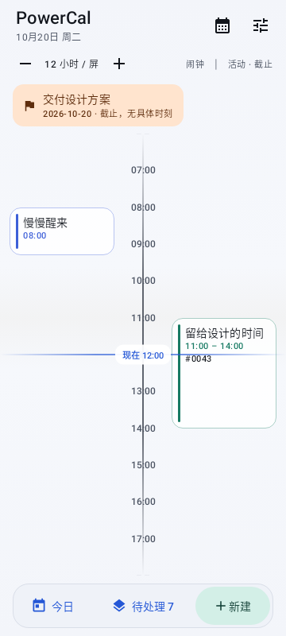
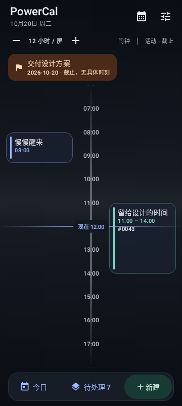
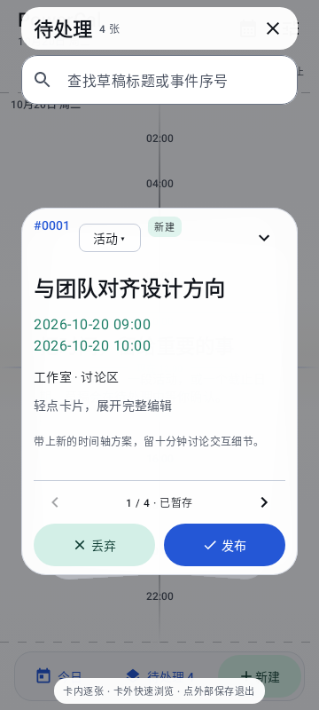
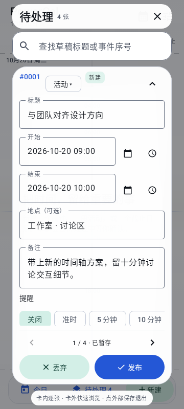
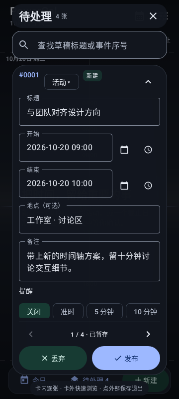
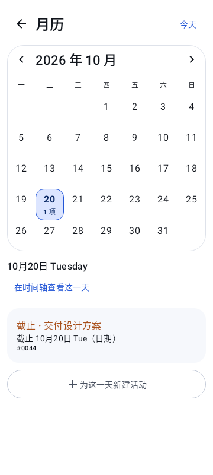

# PowerCal Glass · 软件渲染证据

固定样例数据，360×800 mdpi，Robolectric API 34 native graphics，软件 Canvas 绘制。
这是 Compose 实现的静态审阅图，**不是真机截图，不代表触控、系统键盘、GPU 效果或帧率验收**。
玻璃是高不透明度表面与透明分层模拟，没有宣称真实背景模糊。

`GlassRenderTest` 可重新生成六张图到 `app/build/reports/glass-ui/`。弹窗图合成绘制 Activity 与 Dialog 的视图内容，使用测试草稿，不包含用户数据。
原始测试、lint、APK 哈希与截图校验值见 [validation.json](validation.json)。

## 时间轴：浅色 / 深色

日期截止位于独立日期带；左侧闹钟、右侧区间活动；NOW 在实际时刻。底部保留今日、待处理和新建。

## 待处理：摘要 / 完整编辑 / 深色

主卡保持直立，背景卡片轻微错位旋转；完整表单内部滚动，底部操作与页码独立。搜索不会在打开时主动拉起键盘。
截图不含真实输入法窗口；真实键盘避让需按设备验收单验证。

## 月历与当天日程

七列日期可独立选择，常见 360dp 屏幕为 48dp 日期目标；更窄的设备明确提示水平浏览。大字号/横屏使用整页纵向滚动。
